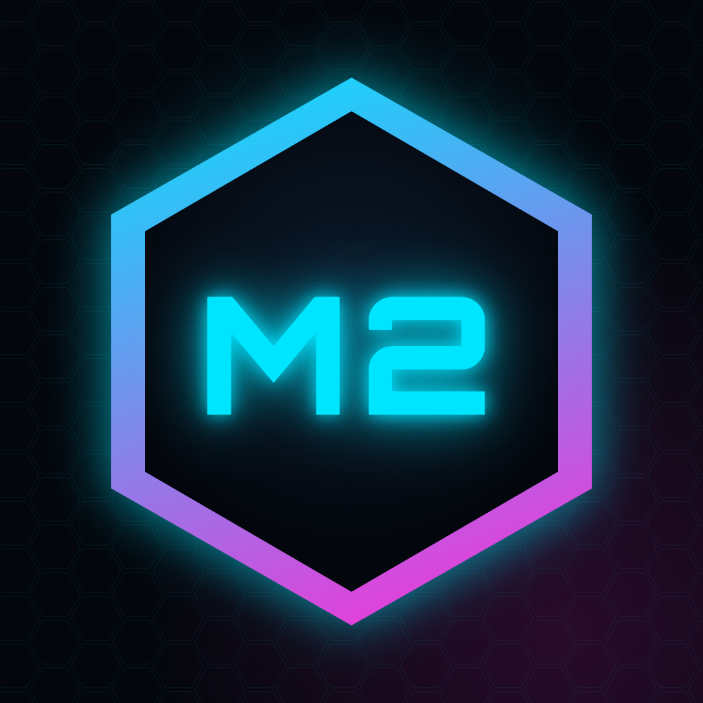

  

<h1 align="center">Mad Two Command Center</h1>

  The launcher for the <b>Mad Two</b> DayZ servers (US and UK): PVE sci-fi survival on Winter Chernarus. 
  Pick a server, let it sort out your mods, and hit <b>DEPLOY</b>.

  <a href="https://github.com/HypJo/madtwo-launcher/releases/latest/download/MadTwo-CommandCenter-Setup.exe"><b>⬇ Download for Windows</b></a>
  &nbsp;·&nbsp;
  <a href="https://github.com/HypJo/madtwo-launcher/releases/latest">All downloads &amp; what's new</a>
  &nbsp;·&nbsp;
  <a href="https://discord.gg/V5RCnyRSF">Join the Discord</a>

---

## Install

1. **[Download the installer](https://github.com/HypJo/madtwo-launcher/releases/latest/download/MadTwo-CommandCenter-Setup.exe)** and run it.
2. If Windows shows **"Windows protected your PC"**, click **More info → Run anyway**. The installer isn't code-signed yet, so Windows doesn't recognise it.
3. Follow the installer, accept the server rules, and launch the Command Center.
4. Make sure **Steam is running** and signed in to the account that owns DayZ.

The launcher updates itself from then on. When a new version is ready, a **RESTART FOR vX** button appears at the top of the window, or it installs next time you close the launcher.

> **On version 1.0.0?** It can't update itself, so download and install the latest version once. Your settings and scores are kept.

## What it does

- **Live server status:** players, ping, queue and in-game time for both servers.
- **Mods handled for you:** missing Workshop mods download through Steam inside the launcher, and outdated ones update before you join, so you don't get kicked for an old mod version.
- **One-click DEPLOY** straight into the server you pick.
- **News, events and rules** from the Mad Two team, with event reminders.
- **Discord:** announcements, who's online, and your Discord profile shows which Mad Two server you're on.
- **Arcade:** a few minigames for while you wait in the queue.

## Portable version

Don't want to install anything? Grab `MadTwo-CommandCenter-Portable-<version>.exe` from the [latest release](https://github.com/HypJo/madtwo-launcher/releases/latest). It runs as-is but can't update itself: it shows a link when a new version is out.

## Problems?

- **"DayZ not found":** open **SYSTEMS** in the launcher and set the folder that contains `DayZ_x64.exe`.
- **Mods won't download:** start Steam, sign in, then press **RESCAN** in **ARSENAL**.
- Anything else: ask in the [Mad Two Discord](https://discord.gg/V5RCnyRSF).

This repository only hosts the launcher's downloads. It is a community launcher and isn't affiliated with Bohemia Interactive or Valve.
